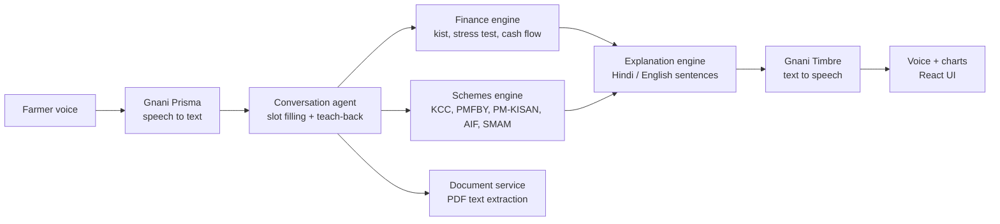
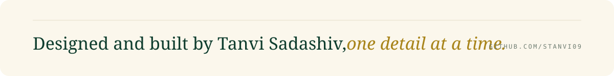

<picture>
  <source media="(prefers-color-scheme: dark)" srcset=".github/assets/header-dark.svg">
  
</picture>

<p align="center">
  <a href="https://kuberket.onrender.com"><b>Open the live app</b></a>
  &nbsp;&nbsp;&middot;&nbsp;&nbsp;
  <a href="https://www.linkedin.com/posts/tanvi-sadashiv-3713ba381_gnaniai-greatindianaiinternshipchallenge-activity-7525514175205453824-Cz6j">Watch the demo</a>
  &nbsp;&nbsp;&middot;&nbsp;&nbsp;
  <a href="https://x.com/Tanvi_Sadashiv/status/2119753963423858854">Demo on X</a>
</p>

<picture>
  <source media="(prefers-color-scheme: dark)" srcset=".github/assets/stats-dark.svg">
  
</picture>

<br>

## 01 &nbsp; Why this exists

Farm loans are sold in minutes: *instant approval, low interest, sign today.* Almost nobody plans for the bad year, when the crop fails or there's a hospital bill and the instalment is still due.

In 2015, the last year NCRB recorded causes, debt was the single biggest reason for farmer suicides: **3,097 farmers, almost 4 in 10** ([source](https://countercurrents.org/2017/01/farmlands-developed-a-bit-more-into-farmer-graveyards-in-2015/)).

KuberKet can't fix credit markets. It can make sure the farmer understands the numbers **before** he signs.

## 02 &nbsp; What it does

A farmer talks to KuberKet in Hindi, Hinglish or English. It asks for his numbers one at a time, reads each one back to confirm it, and then explains:

| Topic | What he hears |
|---|---|
| **His kist** | the monthly instalment, and what's left of his income after it |
| **The bad year** | what happens if income falls 25% or 40% |
| **His year, month by month** | a cash-flow chart that follows his crop calendar, with the lean months marked |
| **Government schemes** | KCC, PMFBY, PM-KISAN, AIF and SMAM compared on *his* numbers |
| **His documents** | upload the loan PDF and ask what it actually says |
| **"What does this mean?"** | ask about any chart or number and get a spoken answer |

## 03 &nbsp; The one rule

> **No AI ever invents a number.**
> Every rupee KuberKet says comes from a unit-tested Python finance engine. The voice layer only turns speech into slots and results back into speech. The maths never goes through a language model.

## 04 &nbsp; How it's built



| Module | Responsibility |
|---|---|
| `finance_engine.py` | EMI (kist) maths, affordability status, income-shock scenarios, monthly cash flow by crop calendar |
| `schemes_engine.py` | Scores each scheme against the farmer's own cash flow and shows the change in risk |
| `conversation_agent.py` | Rule-based slot filling in a fixed order, with every number read back |
| `explanation_engine.py`, `narration.py` | Every sentence the user sees or hears, in Hindi and English |
| `documents_service.py` | Session-only PDF extraction with hard limits (10 MB, 100 pages) |
| `gnani_client.py` | Prisma speech-to-text and Timbre text-to-speech |
| `api.py` | FastAPI: sessions, conversation, numbers, charts, documents, voice |
| `frontend/` | React 19 + TypeScript + Vite: the voice orb, results, year story and charts |

## 05 &nbsp; Details I obsessed over

- **Language purity is tested.** The backend and the frontend each have tests that fail if a Hindi screen leaks a single English word, or the other way round.
- **Real Devanagari type.** The UI uses Noto Sans Devanagari and Baloo 2, so Hindi looks designed, not like a fallback font.
- **Teach-back.** The farmer hears each number repeated before anything is calculated. A misheard "twelve thousand" never turns into a wrong chart.
- **The lean months are named.** Charts don't just dip. The narration says *which* months will be tight.
- **Built for the night before an interview.** `run.bat` builds the frontend on first run and opens the browser. One double-click from a fresh clone.

## 06 &nbsp; Quality

| Suite | Tests | Status |
|---|---:|---|
| Backend, `pytest` | 228 | all passing |
| Frontend, `vitest` + Testing Library | 93 | all passing |

## 07 &nbsp; Run it

Python 3.12+, Node.js 20+ and a Gnani API key.

```bash
git clone https://github.com/Stanvi09/KuberKet.git && cd KuberKet
echo GNANI_API_KEY=your_key > .env
python -m pip install -r requirements.txt
```

| Platform | Command |
|---|---|
| **Windows** | `run.bat` builds the UI on first run and opens http://127.0.0.1:8000 |
| **macOS / Linux** | `(cd frontend && npm install && npm run build)` then `python -m uvicorn api:app --port 8000` |
| **Tests** | `python -m pytest tests -q` and `(cd frontend && npm test)` |

## 08 &nbsp; Repository map

```
KuberKet/
├── api.py                  FastAPI app and routes
├── finance_engine.py       the maths, tested
├── schemes_engine.py       scheme comparison
├── schemes_data.py         scheme rules and parameters
├── conversation_agent.py   slot filling and teach-back
├── explanation_engine.py   Hindi and English copy
├── narration.py            chart and year narration
├── documents_service.py    PDF extraction
├── gnani_client.py         Prisma and Timbre client
├── tests/                  228 backend tests
├── frontend/               React + TypeScript + Vite, 93 tests
├── scripts/                manual API smoke checks
└── docs/                   Gnani speech API notes
```

## 09 &nbsp; Next

Hindi and English today. Gnani Timbre already speaks ten Indian languages, so **Marathi, Tamil, Telugu and Bengali** are next.

<br>

<picture>
  <source media="(prefers-color-scheme: dark)" srcset=".github/assets/footer-dark.svg">
  
</picture>

<p align="center">
  <sub>
    <a href="https://www.linkedin.com/in/tanvi-sadashiv-3713ba381">LinkedIn</a>
    &nbsp;&middot;&nbsp;
    <a href="https://x.com/Tanvi_Sadashiv">X</a>
    &nbsp;&middot;&nbsp;
    <a href="https://github.com/Stanvi09">GitHub</a>
    <br><br>
    <i>KuberKet is education and decision support, not a bank, lawyer or financial adviser.</i>
  </sub>
</p>
