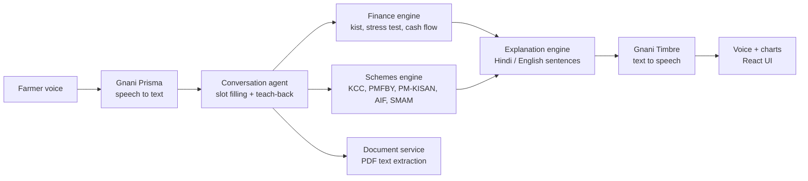

<div align="center">


**Before a farmer signs a loan, KuberKet *tells him out loud* what his monthly kist is and what happens in a bad year.**

[](https://kuberket.onrender.com)
[](https://www.linkedin.com/posts/tanvi-sadashiv-3713ba381_gnaniai-greatindianaiinternshipchallenge-activity-7525514175205453824-Cz6j)
[](https://x.com/Tanvi_Sadashiv/status/2119753963423858854)


<sub>Built for the <b>Great Indian AI Internship Challenge</b> on <b>Gnani Prisma</b> (speech-to-text) and <b>Gnani Timbre</b> (text-to-speech).</sub>

</div>

---

## 🪙 Why this exists

Farm loans are sold in minutes: *"instant approval, low interest, sign today."* Almost nobody plans for the bad year, when the crop fails or there's a hospital bill and the instalment is still due.

In 2015, the last year NCRB recorded causes, **debt was the single biggest reason for farmer suicides: 3,097 farmers, almost 4 in 10** ([source](https://countercurrents.org/2017/01/farmlands-developed-a-bit-more-into-farmer-graveyards-in-2015/)).

KuberKet can't fix credit markets. It *can* make sure the farmer understands the numbers before he signs.

## 🗣️ What it does

A farmer **talks** to KuberKet in **Hindi, Hinglish or English**. It asks for his numbers one at a time, reads every number back to confirm it, then explains:

- 💸 **His monthly kist** and how much money he has left each month
- 🌧️ **A bad-year stress test**: what happens if income falls **25 %** or **40 %**
- 📅 **A month-by-month cash chart** that follows his crop calendar
- 🏛️ **Government schemes compared on his own numbers**: KCC, PMFBY, PM-KISAN, AIF and SMAM
- 📄 **His loan documents**: upload a PDF and ask what it says
- ❓ **"What does this chart mean?"** He can ask about any chart or number and get a spoken answer

## 🔒 The rule I built around

> **No AI ever invents a number.**

Every rupee KuberKet says comes from a **unit-tested Python finance engine**. The voice layer only turns speech into slots and slots back into speech. The maths never goes through a language model.

## 🏗️ Architecture



| Module | Responsibility |
|---|---|
| `finance_engine.py` | EMI (kist) maths, affordability status, income-shock scenarios, monthly cash flow by crop calendar |
| `schemes_engine.py` · `schemes_data.py` | Evaluates each scheme against the farmer's own cash flow and shows the change in risk |
| `conversation_agent.py` | Rule-based slot filling in a fixed order, number confirmation (teach-back) |
| `explanation_engine.py` · `narration.py` | Every user-facing sentence in Hindi and English |
| `documents_service.py` | Session-only PDF text extraction with hard limits (10 MB, 100 pages) |
| `gnani_client.py` | Prisma STT and Timbre TTS client |
| `api.py` | FastAPI app: sessions, conversation, numbers, charts, documents, voice |
| `frontend/` | React 19 + TypeScript + Vite: voice orb, results, year story, charts, documents |

## 🧪 Quality

| Suite | Count | Status |
|---|---|---|
| Backend (`pytest`) | **228** tests | ✅ all passing |
| Frontend (`vitest` + Testing Library) | **93** tests | ✅ all passing |

There are also dedicated **language-purity tests** (backend *and* frontend) that fail if a Hindi screen leaks English text, or the other way round.

## 🚀 Run it locally

Requirements: **Python 3.12+**, **Node.js 20+** and a Gnani API key.

```bash
git clone https://github.com/Stanvi09/KuberKet.git
cd KuberKet
echo GNANI_API_KEY=your_key > .env
python -m pip install -r requirements.txt
```

**Windows:** run `run.bat`. It builds the frontend on first run and opens http://127.0.0.1:8000

**macOS / Linux:**

```bash
(cd frontend && npm install && npm run build)
python -m uvicorn api:app --host 127.0.0.1 --port 8000
```

**Tests:**

```bash
python -m pytest tests -q
(cd frontend && npm test)
```

## 📁 Project structure

```
KuberKet/
├── api.py                    # FastAPI app & routes
├── finance_engine.py         # the maths (tested)
├── schemes_engine.py         # scheme comparison
├── schemes_data.py           # scheme rules & parameters
├── conversation_agent.py     # slot filling + teach-back
├── explanation_engine.py     # Hindi / English copy
├── narration.py              # chart & year narration
├── documents_service.py      # PDF extraction
├── gnani_client.py           # Prisma + Timbre client
├── config.py
├── tests/                    # 228 backend tests
├── frontend/                 # React + TS + Vite (93 tests)
│   └── src/{home,story,year}/
├── docs/                     # Gnani STT / TTS API notes
└── run.bat                   # one-click start on Windows
```

## 🔭 What's next

Hindi and English today. Gnani Timbre already speaks **10 Indian languages**, so **Marathi, Tamil, Telugu and Bengali** are next.

---

<div align="center">

Built by **Tanvi Sadashiv**
<br/>
<a href="https://www.linkedin.com/in/tanvi-sadashiv-3713ba381"></a>
<a href="https://x.com/Tanvi_Sadashiv"></a>
<a href="https://github.com/Stanvi09"></a>

<sub><i>KuberKet is education and decision support, not a bank, lawyer or financial adviser.</i></sub>


</div>
